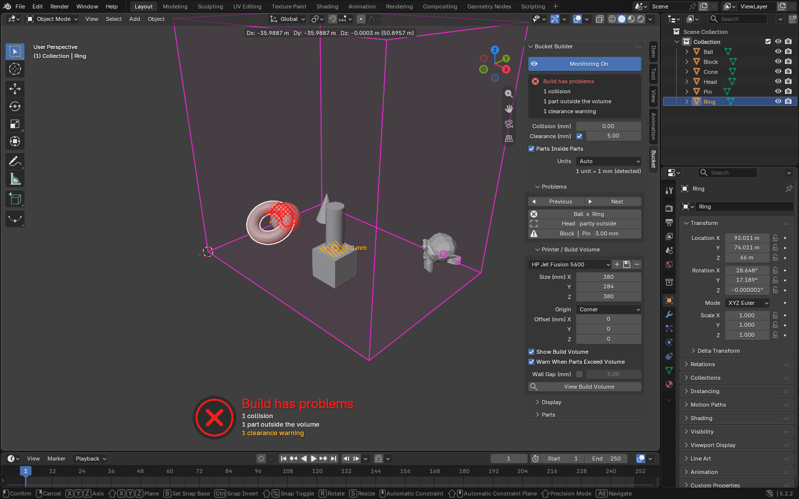
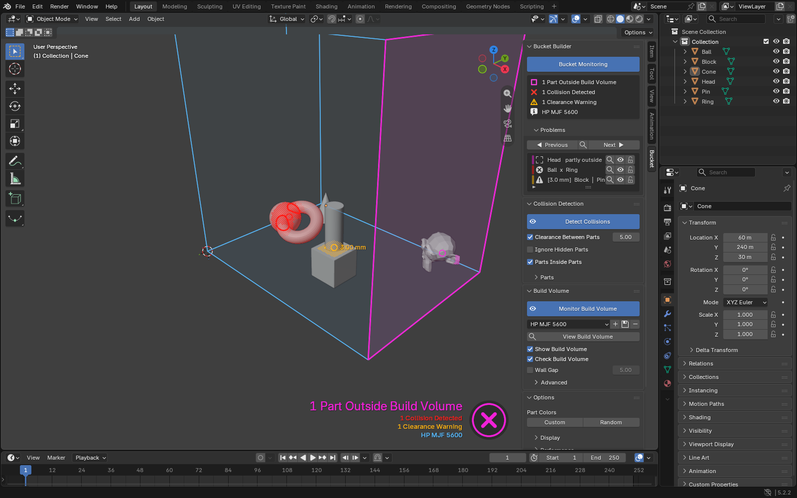
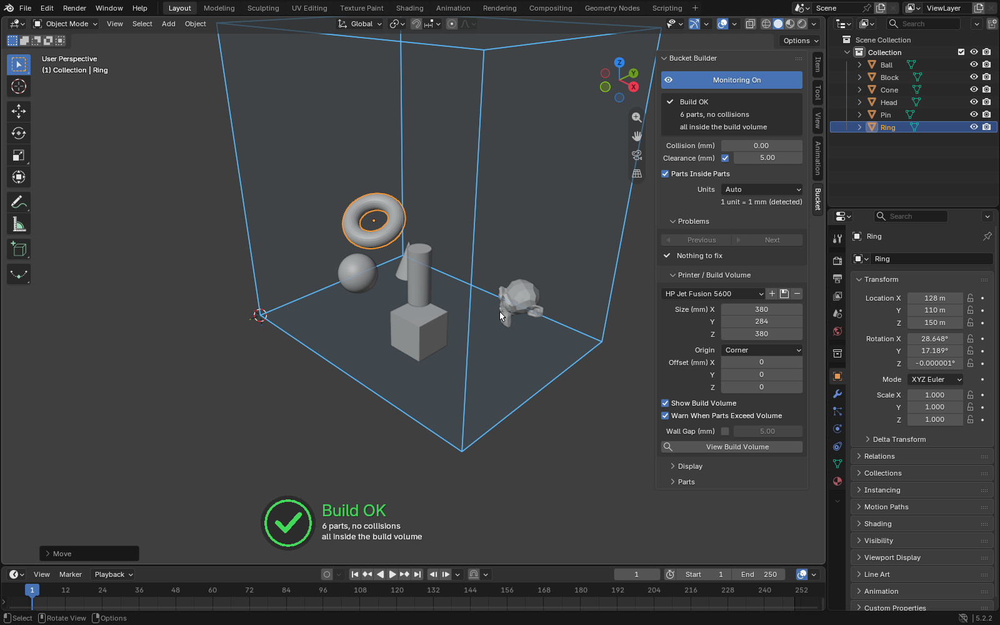
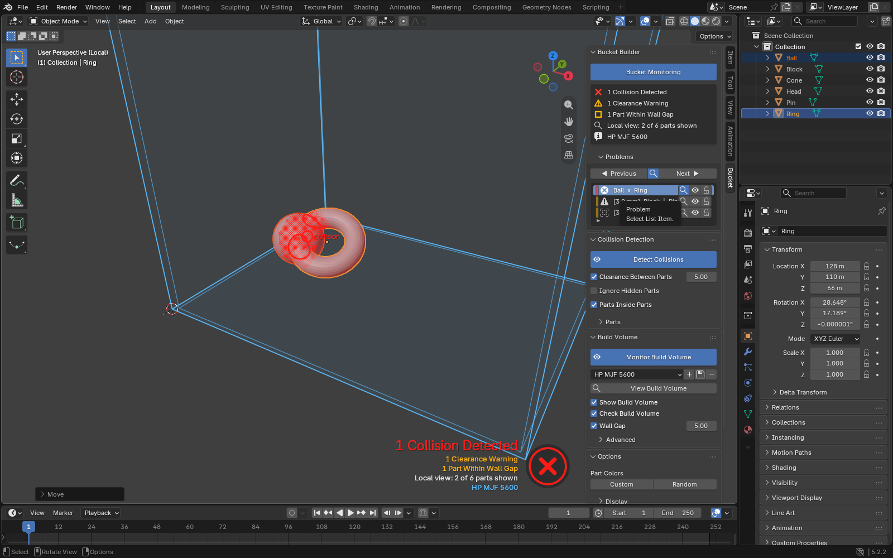
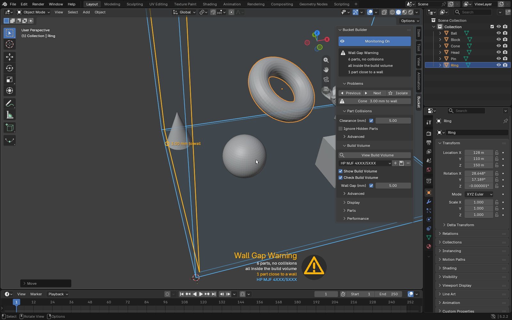

# Bucket Builder

A Blender add-on for preparing dense 3D-print builds ("buckets"), aimed at HP Multi Jet Fusion. It
checks a build live while you arrange it, reports on it, and can pack it for you.

## Features

- **Live build check.** As you move, rotate and scale parts, the viewport shows where they collide
  (red hatching and the exact intersection curve), where they're closer than your minimum clearance
  (amber), and what reaches outside the printer's build volume (magenta). A verdict sits in the
  corner: a green tick when the build is good. Nothing in the scene is changed.
- **Problem list.** Every problem is listed, worst first. One click frames it, a magnifier shows its
  parts on their own, and a problem that's meant to be there can be ignored.
- **Build Report.** Density, packed height and the density of every layer, also available from the
  command line for a 3MF or STL file, without Blender.
- **Arrange.** Drop to the floor, minimize the box or height, tilt off axis, snap into the volume.
- **Pack (experimental).** Packs parts into the volume, trading density against part quality.

| | |
| --- | --- |
|  |  |
|  |  |

*Screenshots from the automated window tests: test shapes in a 380 x 284 x 380 mm volume.*

## Install

Blender 4.2 or newer. Build the zip from this repository:

    blender --command extension build --source-dir bucket_builder --output-dir dist

Then in Blender: Edit > Preferences > Get Extensions > the arrow at the top right > *Install from Disk*.

## Use

The [user guide](bucket_builder/README.md) covers the verdict, the problem list, the Build Report,
Arrange and Pack, plus privacy and the limits worth knowing about.

## How it works

A NumPy engine keeps one bounding-volume tree per unique mesh and applies each part's position at
query time, so dragging a part rebuilds nothing, and only the pairs that changed are recomputed.
Contacts are never left to a search that was cut short. [docs/ENGINE.md](docs/ENGINE.md) has the
design, how it's tested, timings on builds of up to 180 M triangles, and why Blender's own BVHTree
wasn't enough.

## Status

**Version 1.5.0**, in production use by its first user. Tested on Blender 5.2. It's declared for
4.2 and newer, but the versions in between haven't been tried yet.

The add-on is developed almost entirely by an AI assistant (Claude), with little human code review.
The maintainer sets the requirements, tests each build on real work, and reviews the behavior and
the UI. [docs/PROMPT_STATS.md](docs/PROMPT_STATS.md) records how much human steering went in.

## Contributing

[CONTRIBUTING.md](CONTRIBUTING.md) explains how to report issues and send changes. [AGENTS.md](AGENTS.md)
covers setup, tests, layout and conventions, for people and AI assistants alike.
[docs/DECISIONS.md](docs/DECISIONS.md) records why things are built this way, and bugs and plans are
in [Issues](https://github.com/calvin-young/blender-bucket-builder/issues). Background reading:
[PRINT_QUALITY.md](docs/PRINT_QUALITY.md) (how packing affects the parts, with sources),
[AUTOPACK.md](docs/AUTOPACK.md) (the packer's spec) and [DIFFERENTIATORS.md](docs/DIFFERENTIATORS.md).

## License

GPL-3.0-or-later, see [LICENSE](LICENSE).
