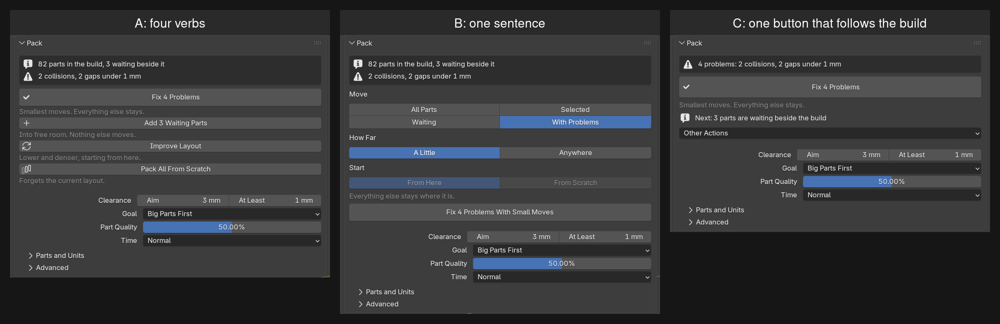
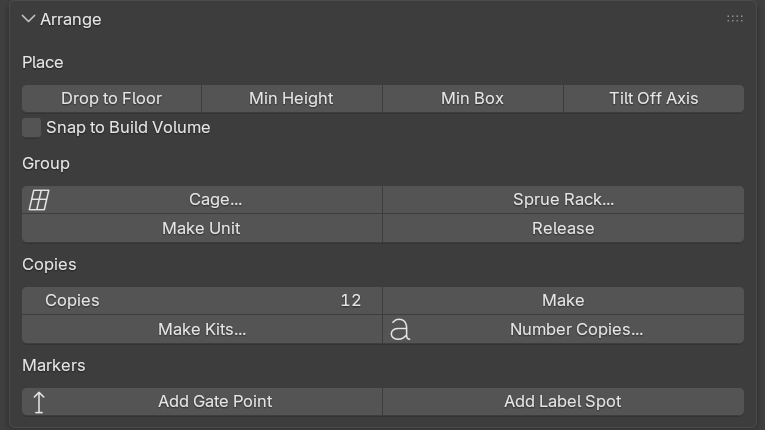
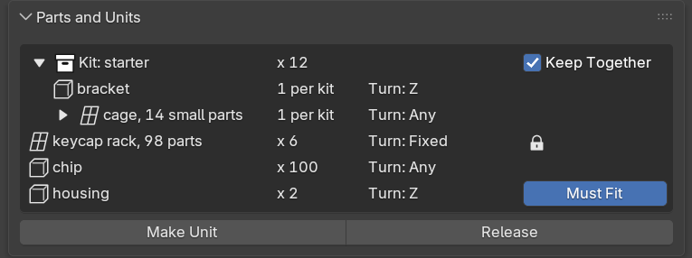

# Pack and Arrange: one design

2026-11-16. A design, not yet built. It covers the Pack actions (#32, #33,
#34), soft clearance (#35), cages (#36), kits (#42), sprues (#41) and
labeled copies (#39). **Status: Claude's proposal.** Nothing here is the
owner's decision until he says so; the choices that need him are listed at
the end.

The mock-ups are drawn in a real Blender 5.2 sidebar with dummy controls
(`docs/images/spec_pack/`).

## 1. The idea in one paragraph

Six issues ask for six features. Underneath they need three things the
add-on does not have yet: a **unit** (several objects that move, pack and
are checked as one body: a cage with its parts, a sprue rack with its
parts, a part with its raised label), a **kit** (a set of parts and units,
made N times, whose copies stay recognizable but are free to go anywhere),
and a **marker** (a point on a part that copies carry along: where a gate
may touch, where a label goes). With those three, a cage is "a fixture
that makes a unit", a sprue rack is "another fixture that makes a unit",
kits are "copies with a number", and labels are "something written at a
marker". And the four Pack actions are one question asked four ways:
*which bodies may move, and how far*.

## 2. The model

### 2.1 Bodies

The packer, Jiggle and the live check work on **bodies**. A body is either
a single part or a unit. Nothing else changes for them: a body has a
shape, a turning rule (Fixed, Turn About Z, Any), a lock, and "must fit".

### 2.2 Units

**A unit is a parent object with its children, marked Packs As One.**

* In Blender it is plain parenting, nothing new to learn: move the parent
  and everything follows; the Outliner shows what belongs to it;
  Duplicate Linked on the hierarchy makes another one.
* The parent is the fixture when there is one (the cage, the sprue rail),
  so clicking the cage and moving it moves the lot. A unit without a
  fixture ("keep these three together") gets an Empty as its parent.
* Stored on the parent: `bucket_builder_unit = True`. On members:
  `bucket_builder_role`, one of Part, Cage, Sprue, Label.
* **Rigid for our tools, not for the user.** Pack, Jiggle and Add move the
  parent only. The user can still grab a part inside its cage and re-seat
  it; the fixture then offers Rebuild.
* **Arrange > Make Unit** and **Release** turn a selection into a unit and
  back. Cage and Sprue Rack make units by themselves.

What the live check does inside a unit depends on the role:

| Pair | Rule | Why |
| --- | --- | --- |
| Sprue or Label against a part of its own unit | Not a problem, and **must** touch: a part that does not reach its sprue is reported as "loose from its sprue" | They are meant to print as one piece |
| Cage against its contents; contents against each other | Checked against the *minimum* clearance | A part fused to its cage is a classic failure |
| Anything against another unit or a loose part | The normal rules | |

Today the monitor reports collection instances as "not checked". They are
rigid by nature, so they can become units later; not in the first version.

### 2.3 Kits

**A kit is a named set of bodies, made N times.** Its copies are *not*
rigid: kit 7's bracket and kit 7's cage may end up far apart if that packs
better. What a kit keeps is identity.

* Stored on the Scene: a list of kits (name, count, Keep Together).
  Stored on each member body: the kit's id and its copy number (1 to N),
  and which body of kit 1 it is a copy of.
* **Kit 1 is the recipe.** There is no hidden parts list: what kit 1
  contains is what a kit contains. **Update Kits** makes the others match
  it: a part added to kit 1 appears in every kit (the new copies wait
  beside the build), one removed disappears everywhere. Changing the count
  adds or removes whole kits.
* Copies are linked duplicates (shared mesh data), so 12 kits cost the
  memory of one.
* **A plain quantity is a kit of one body.** "Copies: 40" on a part makes
  39 linked duplicates with a copy number and no kit name. One mechanism
  for "40 of these" and "12 of this set".
* What identity buys: a number on each kit (labels, section 6), a color
  per kit in the viewport, a parts list per kit (a CSV for whoever sorts
  after depowdering), and Keep Together for the packer.

### 2.4 Markers

**A marker is a small Empty parented to a part**, pointing out of the
surface. Two kinds: **Gate Point** (a sprue may attach here) and **Label
Spot** (a label goes here, this way up, this size). Because it is a child
object, every copy of the part carries its markers, and Blender's own
tools move, delete and duplicate them. Placing one: Arrange > Add Gate
Point, then click the surface; it snaps to the face and aligns to its
normal.

Markers answer "where" once per part, instead of once per copy or by
guessing. Marking whole faces as non-cosmetic (#41) can come later as a
way to *propose* gate points; the sprue builder only ever reads points.

### 2.5 Fixtures

A cage, a sprue rail and a raised label are **generated objects**. Each
remembers the settings it was made with (custom properties on the object),
so **Rebuild** remakes it after its contents moved or a setting changed.
Parts are never modified. The one exception is an engraved label, which
by its nature needs its own mesh: it is made on a copy, and the original
stays as it was.

## 3. Pack: the actions (#33, #34)

### 3.1 What people actually do

| Situation | What should happen | Today |
| --- | --- | --- |
| Loose parts, empty build | Pack everything | Pack |
| A hand pack with a few clashes | Fix them with the smallest moves; respect the rest | Jiggle |
| A loose or half-finished pack | Make it lower and denser, starting from what is there | Jiggle & Tighten, Improve Current Layout |
| A finished build, a last-minute part | Put it in the free room; move nothing else | lock everything by hand, then Pack |

Every row is the same run with two things varied: **which bodies may
move** (all, the ones with problems, the new ones) and **how far** (a
nudge, or anywhere). Everything not named stays exactly where it is.

| Action | May move | How far | Starts from |
| --- | --- | --- | --- |
| **Fix Problems** | bodies with a problem | a nudge; a body that needs more is reported, not thrown across the build | here |
| **Add Waiting Parts** | selected bodies, or else every body outside the volume | anywhere | here; the build is locked |
| **Improve Layout** | every unlocked body | nudges first, then anywhere | here |
| **Pack All From Scratch** | every unlocked body | anywhere | nothing |

"Waiting" means a body that lies outside the build volume. It is how the
add-on already shows parts that did not fit, and where new copies appear.
A locked body never moves in any action.

Jiggle, Jiggle & Tighten and Improve Current Layout disappear as names.
Fix Problems is Jiggle; Improve Layout is the other two, which were
already the same loop started at different points.

### 3.2 Three directions for the panel

**A. Four verbs.** One button per action, each with a line saying what it
does and what it leaves alone. The one that fits the build's state is the
large one; an action with nothing to do is greyed ("Add" with nothing
waiting).

**B. One sentence.** Three choices (which parts, how far, start from) and
one button whose text says what it is about to do. It is the model itself
on screen: nothing hidden, every combination reachable, including ones
the verbs do not name (improve only the selection).

**C. One button that follows the build.** The panel reads the build and
offers the single action that makes sense now; the others are in a menu.

**Recommendation: A.**

* B is honest but it asks a new user three questions before they can do
  anything, and two of its eight combinations are nonsense.
* C is the fastest when it guesses right and the most confusing when the
  button changes under the user's hand, or when they want the other
  action and have to find it.
* A costs four buttons. It names each use case in the user's own words,
  and its status lines carry C's best part (the panel tells you what it
  sees). B's extra combinations are covered by one rule that needs no
  control: **with a selection, Improve and Fix act on the selection.**

### 3.3 The result stays, and names what is left (#32)

After any action a result box stays in the panel until the next action or
its ✕. It says what was done (problems solved, bodies moved and how far),
what is left and **why**, in one of these phrases:

* "needs more than a nudge" (over 20 mm wrong: Fix leaves these),
* "no room found in the time given",
* "blocked by a locked part",
* "does not fit this printer at all",
* "placed with less clearance than you aim for" (section 4).

Two buttons act on the leftovers: **Select Them** and **Pack These Again**
(which is Add for exactly those bodies). The leftovers are also the
selection when the action ends, and they are in the Problems list anyway.
Every action is one undo step.

### 3.4 Without Blender (#34)

`python -m buildcore.pack add build.3mf part.3mf --count 3 --out new.3mf`.
The build's file is not rewritten: the new objects and build items are
spliced into its model text, so names, metadata, colors and anything this
tool does not understand come out byte for byte as they went in. It
prints where each part went, or that there was no room and why.

## 4. Soft clearance (#35)

Two numbers instead of one: **Aim** (3 mm) and **At Least** (1 mm).

| Gap | Live check | Packer and Fix |
| --- | --- | --- |
| under At Least | a problem; the build fails | never allowed |
| between the two | a note that does not fail the build: "14 gaps under 3 mm, smallest 1.6" | allowed at a cost that grows as the gap shrinks |
| Aim or more | nothing | free |

* **Live check.** The engine already has two thresholds (the old
  "collision distance" and the clearance); they become At Least and Aim.
  The overlay gains one quieter color for "under the aim".
* **Fix Problems** solves what is under At Least first, by the smallest
  moves, and widens gaps toward the aim only where that costs nothing
  else. On a tight hand pack that is the behavior wanted: clashes gone,
  the layout otherwise as the person left it.
* **Packing** in two steps, cheapest first. Step 1 (build first): pack at
  the aim; bodies left over are tried again at At Least, and the result
  says which ones were squeezed in. Step 2 (later, if the Magics and
  Netfabb numbers say density is lost here): the search scores placements
  by how much of the band between the two it uses.
* Inside a cage the contents are held to At Least, not the aim: a cage is
  small on purpose.
* The reference test is the owner's hand-packed challenge build (local
  only): Fix Problems must clear its clashes at At Least 1 mm without
  moving any part more than a few millimeters.

## 5. Arrange: fixtures and copies

Arrange stays what it is, tools that act on the selection, and gains
three groups: Group, Copies, Markers.

### 5.1 Cage (#36)

Select parts, press **Cage**. A dialog asks three things:

* **Contents:** As They Are / Compact (smallest box) / Flat (lowest).
  The last two run the packer on just these parts in a box that shrinks
  until they no longer fit.
* **Strength:** Light / Standard / Strong. Sets bar thickness and width.
* **Window:** Automatic, or a size. Automatic is the largest window that
  still holds the smallest part in, by its smallest bounding dimension.

The numbers behind the three strengths, the smallest window that still
lets blasting media through, and the clearance to the contents are **not
known yet**: they need the owner's experience and sources in
`docs/PRINT_QUALITY.md` before the defaults mean anything. The first
version ships with adjustable numbers under Advanced and says so.

The cage is a box in the first version (a hull-shaped cage saves volume
and comes later). It becomes the parent of its contents: a unit. The
packer treats a cage as solid, because nothing else may be placed inside
it. **Rebuild** remakes it.

### 5.2 Kits and copies (#42)

* **Copies [12] Make:** linked duplicates of each selected body, waiting
  beside the build.
* **Make Kits...:** the selection becomes kit 1; N - 1 more are made.
  The dialog asks the name, the count and Keep Together.
* The owner's workflow in #42 is then three presses: select the small
  parts, **Cage** (Compact); select the cage and the big parts, **Make
  Kits** 12; **Add Waiting Parts** or **Pack All**.

### 5.3 Sprue racks (#41)

A rack is a unit: one rail object and its parts, overlapping at the gates.

* **Level 1, swap the part.** Select a rack (or all racks) and a new
  part: **Replace Part**. Because the parts of a rack are linked copies,
  this is one change of mesh for all of them. The new part is seated by
  its Gate Points if it has them, else by its origin. The live check then
  says at once whether every part still reaches its sprue and whether
  neighbors now collide.
* **Level 2, build the racks.** Give the part Gate Points and pick a
  polisher (rack length, hook spacing, part count per rack). The lattice
  packer arranges the copies in rows with the gate points facing a rail;
  the rail and gates are generated between them; each rack becomes a
  unit and the racks are packed. This is a prototype first: how far it
  goes is judged on a real part with the owner, and it needs the
  polisher's dimensions from him.

### 5.4 Numbered copies (#39)

**Number Copies...** on a selection of copies or kits:

* **Text:** a pattern, `{kit}-{n}`, `SN{n:03}`, with a start number.
* **Where:** the part's Label Spot. Without one, the dialog asks the user
  to place one first (one click), instead of guessing a face.
* **How:**
  * **Raised:** a small text body, a child of the part with the role
    Label. Copies stay linked; nothing is cut. First to build.
  * **Engraved:** each copy gets its own mesh with the text cut in. Costs
    memory and a boolean per copy; second.
  * **Printed:** handed to Decal Press when it is installed (its labels
    milestone); otherwise the choice is greyed with "needs Decal Press".
* For kits, the number can go on the cage instead: Cage gets a "Label
  Plate" option, a flat bar with a Label Spot on it.

Text becomes a mesh through Blender's own text object, so Bucket Builder
needs nothing from Decal Press for raised and engraved labels.

## 6. The list: parts, units and kits

The Pack panel's part list becomes the place where bodies are seen as the
packer sees them: a kit with its count and what one kit contains, a unit
as one row that opens to show its members, a plain part with its number
of copies. Per row: how it may turn, the lock, Must Fit. Editing a count
here is the same as Copies or Update Kits.

## 7. How the packer treats units and kits

* **Shape.** A unit's shape is the union of its members' shapes in the
  parent's frame. A cage is closed first (windows filled), so it is
  solid; a sprue rack is taken as it is.
* **Identical units share the work.** Units made as copies know which
  unit they copy, so a few dozen racks are voxelized once, and the lattice packer
  can arrange them as it arranges identical parts.
* **Turning.** The parent's rule. A sprue rack that must hang one way is
  Fixed or Turn About Z; a cage is usually Any.
* **Result.** One matrix per body, applied to the parent.
* **Fix, Improve, Add** move parents only. The exact engine sees every
  member as it does today, with the unit rules of section 2.2.
* **Keep Together** (per kit): Off, or Prefer. Prefer places a kit's
  bodies one after another, so they land near each other, and adds a
  small cost for a kit that is spread out. It never costs a part its
  place in the build.
* **Density and height** count a unit by its members' real volume (cage
  bars are sintered powder too).
* **Getting units out.** Racks and cages must come apart after printing.
  The interlocking check in `docs/AUTOPACK.md` §8.9 (designed, not built)
  matters more with units than without and moves up with them.

## 8. Order of building

Each step is useful by itself and makes the next one smaller.

| Step | What | Issues | Rests on |
| --- | --- | --- | --- |
| 1 | Two clearances in the live check and in Fix Problems; the result box | #35, #32 | the engine's two thresholds, Jiggle |
| 2 | The four actions; Add Waiting Parts (the button) | #33, #34 | the packer's lock, today's worker modes |
| 3 | Units: Make Unit / Release, the live-check rules, the packer's union shape | #42 (first gap) | steps 1 - 2 |
| 4 | Cage, box-shaped, around parts as they are; then Compact and Flat | #36 | step 3 |
| 5 | Copies and kits; the list of section 6; the parts list per kit | #42 | step 3 |
| 6 | Markers; Number Copies, raised first | #39 | step 5 |
| 7 | Sprues: Replace Part and "loose from its sprue"; then the level 2 prototype | #41 | steps 3, 6 |
| 8 | `buildcore.pack add` | #34 | the package (audit, D5) |

Steps 1 and 2 are what the owner meets every day and need no new
concept; they come before any unit. Step 3 is the enabling one: after
it, cages, racks and kits are mostly tools that make and tag objects.

**Before step 3:** the audit's open items on trust (`docs/AUDIT.md`: #19
in a window, the independent checker). Units add rules to the live check;
they should land on a check that is known to be right.

## 9. Where this differs from the issues as written

* **#33** asked for "perhaps one Improve button with a how-far choice".
  That is direction B. I recommend four named actions instead: the
  how-far choice is real, but it reads better as the difference between
  Fix and Improve than as a setting.
* **#36** asks for cage defaults that survive blasting. The design gives
  the controls; the numbers are not mine to invent.
* **#41** proposes marking non-cosmetic faces. Points are simpler to
  place, to see and to copy, so the sprue builder reads points only.
* **#42** calls a kit "a set with a count". It is that, plus kit 1 as the
  visible recipe, which removes the need for a separate kit editor.
* **#39** lists embossed labels as "copies stay instances". They do, and
  the raised label is then just another member of a unit, checked by the
  same rule as a sprue.

## Requested, assumed, not asked

* **Requested:** one design on one model for #32 - #36, #39, #41, #42;
  the data model, the interface in two or three directions, how the
  packer treats units, the order of building.
* **Assumed:** units are parent and children, not collections; kit 1 is
  the recipe; markers are Empties; the clearance names "Aim" and "At
  Least"; "waiting" for bodies outside the volume; the action names.
* **Not asked (the owner's to decide):**
  1. Direction A, B or C for the Pack panel.
  2. Cage numbers: bar sizes for the three strengths, the smallest
     useful window, clearance to the contents.
  3. The polisher's rack and hook dimensions, and parts per rack.
  4. Whether a gap between At Least and Aim should ever fail the build
     (for instance more than some number of them).
  5. Raised or engraved first, for his own jobs.
* **Follow-ups:** hull-shaped cages; collection instances as units;
  proposing gate points from marked faces; a color per kit in the 3MF.
