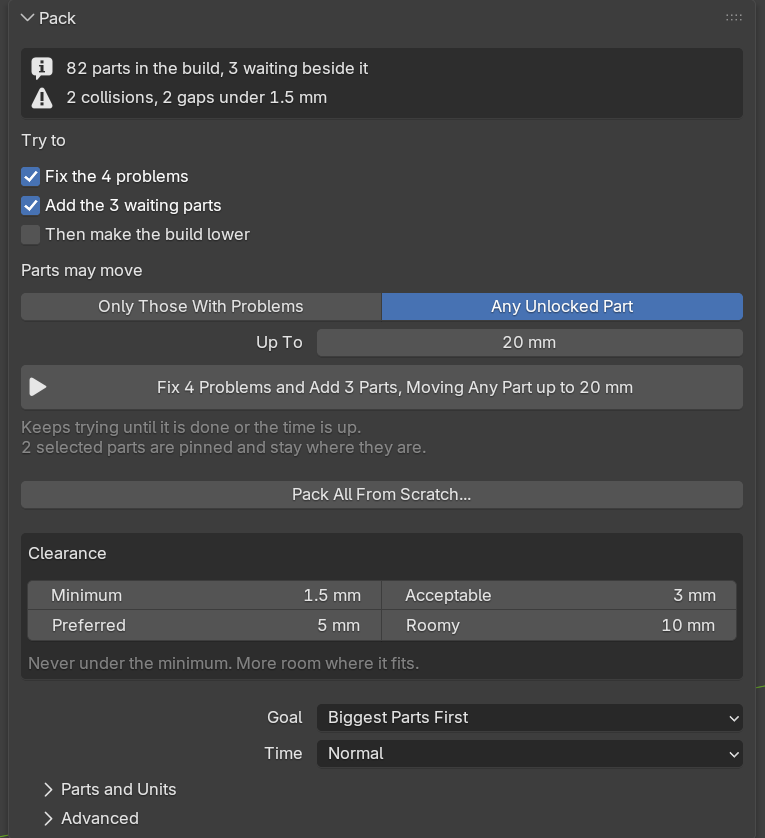
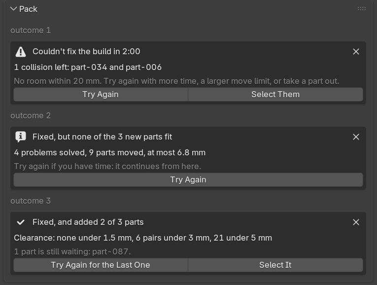
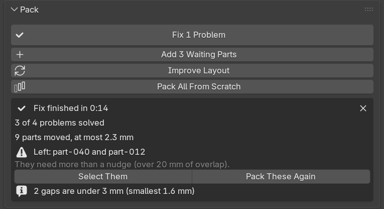

# Pack and Arrange: one design

2026-11-16. A design, not yet built. It covers the Pack actions (#32, #33,
#34), soft clearance (#35), cages (#36), kits (#42), sprues (#41) and
labeled copies (#39). **Status: Claude's proposal.** Nothing here is the
owner's decision until he says so; the choices that need him are listed at
the end.

The mock-ups are drawn in a real Blender 5.2 sidebar with dummy controls
(`docs/images/spec_pack/`).

## 1. The idea in one paragraph

Six issues ask for six features. Underneath they need three things the
add-on does not have yet: a **unit** (several objects that move, pack and
are checked as one body: a cage with its parts, a sprue rack with its
parts, a part with its raised label), a **kit** (a set of parts and units,
made N times, whose copies stay recognizable but are free to go anywhere),
and a **marker** (a point on a part that copies carry along: where a gate
may touch, where a label goes). With those three, a cage is "a fixture
that makes a unit", a sprue rack is "another fixture that makes a unit",
kits are "copies with a number", and labels are "something written at a
marker". And the four Pack actions are one question asked four ways:
*which bodies may move, and how far*.

## 2. The model

### 2.1 Bodies

The packer, Jiggle and the live check work on **bodies**. A body is either
a single part or a unit. Nothing else changes for them: a body has a
shape, a turning rule (Fixed, Turn About Z, Any), a lock, and "must fit".

### 2.2 Units

**A unit is a parent object with its children, marked Packs As One.**

* In Blender it is plain parenting, nothing new to learn: move the parent
  and everything follows; the Outliner shows what belongs to it;
  Duplicate Linked on the hierarchy makes another one.
* The parent is the fixture when there is one (the cage, the sprue rail),
  so clicking the cage and moving it moves the lot. A unit without a
  fixture ("keep these three together") gets an Empty as its parent.
* Stored on the parent: `bucket_builder_unit = True`. On members:
  `bucket_builder_role`, one of Part, Cage, Sprue, Label.
* **Rigid for our tools, not for the user.** Pack, Jiggle and Add move the
  parent only. The user can still grab a part inside its cage and re-seat
  it; the fixture then offers Rebuild.
* **Arrange > Make Unit** and **Release** turn a selection into a unit and
  back. Cage and Sprue Rack make units by themselves.

What the live check does inside a unit depends on the role:

| Pair | Rule | Why |
| --- | --- | --- |
| Sprue or Label against a part of its own unit | Not a problem, and **must** touch: a part that does not reach its sprue is reported as "loose from its sprue" | They are meant to print as one piece |
| Cage against its contents; contents against each other | Checked against the *minimum* clearance | A part fused to its cage is a classic failure |
| Anything against another unit or a loose part | The normal rules | |

Today the monitor reports collection instances as "not checked". They are
rigid by nature, so they can become units later; not in the first version.

### 2.3 Kits

**A kit is a named set of bodies, made N times.** Its copies are *not*
rigid: kit 7's bracket and kit 7's cage may end up far apart if that packs
better. What a kit keeps is identity.

* Stored on the Scene: a list of kits (name, count, Keep Together).
  Stored on each member body: the kit's id and its copy number (1 to N),
  and which body of kit 1 it is a copy of.
* **Kit 1 is the recipe.** There is no hidden parts list: what kit 1
  contains is what a kit contains. **Update Kits** makes the others match
  it: a part added to kit 1 appears in every kit (the new copies wait
  beside the build), one removed disappears everywhere. Changing the count
  adds or removes whole kits.
* Copies are linked duplicates (shared mesh data), so 12 kits cost the
  memory of one.
* **A plain quantity is a kit of one body.** "Copies: 40" on a part makes
  39 linked duplicates with a copy number and no kit name. One mechanism
  for "40 of these" and "12 of this set".
* What identity buys: a number on each kit (labels, section 6), a color
  per kit in the viewport, a parts list per kit (a CSV for whoever sorts
  after depowdering), and Keep Together for the packer.

### 2.4 Markers

**A marker is a small Empty parented to a part**, pointing out of the
surface. Two kinds: **Gate Point** (a sprue may attach here) and **Label
Spot** (a label goes here, this way up, this size). Because it is a child
object, every copy of the part carries its markers, and Blender's own
tools move, delete and duplicate them. Placing one: Arrange > Add Gate
Point, then click the surface; it snaps to the face and aligns to its
normal.

Markers answer "where" once per part, instead of once per copy or by
guessing. Marking whole faces as non-cosmetic (#41) can come later as a
way to *propose* gate points; the sprue builder only ever reads points.

### 2.5 Fixtures

A cage, a sprue rail and a raised label are **generated objects**. Each
remembers the settings it was made with (custom properties on the object),
so **Rebuild** remakes it after its contents moved or a setting changed.
Parts are never modified. The one exception is an engraved label, which
by its nature needs its own mesh: it is made on a copy, and the original
stays as it was.

## 3. Pack: the actions (#33, #34)

### 3.1 What people actually do

| Situation | What should happen | Today |
| --- | --- | --- |
| Loose parts, empty build | Pack everything | Pack |
| A hand pack with a few clashes | Fix them with the smallest moves; respect the rest | Jiggle |
| A loose or half-finished pack | Make it lower and denser, starting from what is there | Jiggle & Tighten, Improve Current Layout |
| A finished build, a last-minute part | Put it in the free room; move nothing else | lock everything by hand, then Pack |

Every row is the same run with two things varied: **which bodies may
move** (all, the ones with problems, the new ones) and **how far** (a
nudge, or anywhere). Everything not named stays exactly where it is.

| Action | May move | How far | Starts from |
| --- | --- | --- | --- |
| **Fix Problems** | bodies with a problem | a nudge; a body that needs more is reported, not thrown across the build | here |
| **Add Waiting Parts** | selected bodies, or else every body outside the volume | anywhere | here; the build is locked |
| **Improve Layout** | every unlocked body | nudges first, then anywhere | here |
| **Pack All From Scratch** | every unlocked body | anywhere | nothing |

"Waiting" means a body that lies outside the build volume. It is how the
add-on already shows parts that did not fit, and where new copies appear.
A locked body never moves in any action.

Jiggle, Jiggle & Tighten and Improve Current Layout disappear as names.
Fix Problems is Jiggle; Improve Layout is the other two, which were
already the same loop started at different points.

### 3.2 The panel: one action that keeps trying (revised 2026-11-17)

The first version of this section offered three directions (A: four verbs,
B: one sentence, C: one button that follows the build) and recommended A.
The owner's answer changed it, and he is right on the main point:

* He likes **B's sentence**: the button says what it is about to do, in
  the options chosen. And **A's clarity**.
* But **the user should not have to choose between fixing and adding.**
  Nobody knows beforehand whether the clashes can be fixed, whether the new
  parts fit, or whether both can be done together. Separate buttons make
  the user guess and try them in turn.

**Direction D, adopted as the design:** one action that aims at everything
asked for, keeps trying until it is done or the time is up, and ends with
an outcome that says what happened and what to do next.

What the user chooses, in plain sentences:

* **Try to:** fix the problems (ticked when there are any), add the
  waiting parts (ticked when there are any), and then make the build lower
  (off by default: it moves everything, which a hand pack does not want).
* **Parts may move:** only those with problems, or any unlocked part.
* **Up to:** how far a part may end up from where it was (20 mm by
  default). It keeps the search quick and near a solution; it is not a rule
  of the build, so it is a number the user can raise (the owner, 2026-11-17).

The button spells it out: "Fix 4 Problems and Add 3 Parts, Moving Any Part
up to 20 mm". Unticking a box changes the sentence.

What the run does, cheapest first, until everything asked is done or the
time is up:

1. Small moves (today's Jiggle, with the clearance tiers of section 4).
2. **Re-seat:** take out the part that blocks most, and place it in the
   build's free room with every other part held, in any of the 24 axis
   turns. This is what the owner did by hand on the challenge build: three
   plates turned 90 degrees and moved elsewhere opened the crowded row
   that no small move could. It is the same step as adding a waiting part.
3. Add the waiting parts into the free room, at the best clearance tier
   that fits each.
4. If asked, make the build lower (today's Improve).

Every pass starts from the best layout so far, so **Try Again continues**;
it never throws away what was won.

**The outcome** (the result box of 3.3 stays, with one of these heads):

1. "Couldn't fix the build": what is left, and why, and what would help
   (more time, a larger move limit, taking a part out).
2. "Fixed, but none of the new parts fit": try again if there is time.
3. "Fixed, and added 2 of 3": try again for the last one.
4. "Done": everything asked, with the clearance tiers reached.

**What stays separate, and why:**

* **Pack All From Scratch...** forgets the layout. It cannot be a step of
  "keep trying", which promises to keep what is there, so it is its own,
  smaller button, and it asks first.
* "Make the build lower" is a checkbox, not the default. It is the one
  step that moves parts nobody asked to move.

**The owner's open points, answered:**

* *A pinned part that is selected:* pinned wins, with a note under the
  button ("2 selected parts are pinned and stay"). Agreed.
* *Goal and Must Fit / Nice to Have:* priority tiers first, the Goal
  second. A part marked Must Fit is placed before any other, and a Nice to
  Have is never placed at the cost of a part above it. Among parts of one
  tier the Goal decides (biggest parts first, most parts, lowest build).
  The panel says so in the Goal's tooltip and in the outcome ("1 Nice to
  Have part left out"). Two tiers are enough (Must Fit, and the rest), plus
  Nice to Have as a third if the owner wants it; today's code has tiers
  already (`Part.tier`).

**Where I still push back:** a "keep trying" button must say when it has
stopped making progress, or users will press Try Again forever. The
outcome says "no better layout found in the last 2 minutes" when that is
the case, and offers the concrete next step instead of Try Again.

### 3.3 The result stays, and names what is left (#32)

After any action a result box stays in the panel until the next action or
its ✕. It says what was done (problems solved, bodies moved and how far),
what is left and **why**, in one of these phrases:

* "needs more than a nudge" (over 20 mm wrong: Fix leaves these),
* "no room found in the time given",
* "blocked by a locked part",
* "does not fit this printer at all",
* "placed with less clearance than you aim for" (section 4).

Two buttons act on the leftovers: **Select Them** and **Pack These Again**
(which is Add for exactly those bodies). The leftovers are also the
selection when the action ends, and they are in the Problems list anyway.
Every action is one undo step.

### 3.4 Without Blender (#34)

`python -m buildcore.pack add build.3mf part.3mf --count 3 --out new.3mf`.
The build's file is not rewritten: the new objects and build items are
spliced into its model text, so names, metadata, colors and anything this
tool does not understand come out byte for byte as they went in. It
prints where each part went, or that there was no room and why.

## 4. Clearance tiers (#35, revised 2026-11-17)

Not two numbers but tiers, from the owner's practice for builds like the
challenge build:

| Tier | Default | Meaning |
| --- | --- | --- |
| **Minimum** | 1.5 mm | the hard rule: never under it |
| **Acceptable** | 3 mm | fine for most pairs |
| **Preferred** | 5 mm | what a careful hand pack aims for |
| **Roomy** | 10 mm | "whatever you can get away with": more is better up to here |

| Gap | Live check | Packer and Fix |
| --- | --- | --- |
| under Minimum | a problem; the build fails | never allowed |
| Minimum to Acceptable | an amber note, counted in the badge ("6 gaps under 3 mm") | allowed at a high cost |
| Acceptable to Preferred | listed, quiet | allowed at a small cost |
| Preferred to Roomy | not shown | a tiny cost, so free room is shared out |
| Roomy or more | nothing | free |

* **The minimum is a strong preference, not a wall** (the owner,
  2026-11-17). His challenge build was first finished in another tool with
  one 0.6 mm gap over a tiny area, which he accepted and which printed
  fine; he would have been happy with "1.5 mm is not possible; here is a
  compromise with 0.6 mm over a small area". So a gap under the minimum is
  allowed at a very high cost that grows with the **area** in close contact
  (#43), never silently: the outcome lists each compromise (where, how
  close, over how much area) for the user to accept, or to try again
  without a part. A collision is still never allowed.
* **Alternative layouts** (#45): when the request cannot be met cleanly,
  the run may offer two or three results side by side instead of one,
  for example "7 of each with two compromises" against "6 of each, every
  gap at 3 mm or more", so nobody loops over counts and the quality slider
  by hand. Ratios are kept: a build of kits or 1:1 sets (#42) drops whole
  sets, never single parts.
* **The cost** is one curve made of the tiers: steep under Acceptable,
  gentle under Preferred, nearly flat under Roomy. Pairs are ranked by it,
  so the tightest gaps are always widened first.
* **Which pairs matter most** is not the smallest gap alone: two plates
  2 mm apart over a large area matter more than two spheres at 1 mm (#43).
  When the contact area is measured (with #44's exact hatching), the cost
  and the list of warnings weigh it.
* **Packing:** at Preferred first; parts left out are tried at Acceptable,
  then at Minimum (squeezed in, or everything packed again at that tier,
  whichever places more; `pack/soft.py` does this for two tiers today);
  then Jiggle shares the slack out toward Roomy.
* **Jiggle** solves what is under Minimum first, then widens gaps tier by
  tier where that costs nothing else.
* Inside a cage the contents are held to Minimum: a cage is small on
  purpose.
* The defaults belong to the kind of build (the owner gave these for
  hand-packed buckets of mid-size parts); a printer or material profile
  may change them later.

## 5. Arrange: fixtures and copies

Arrange stays what it is, tools that act on the selection, and gains
three groups: Group, Copies, Markers.

### 5.1 Cage (#36)

Select parts, press **Cage**. A dialog asks three things:

* **Contents:** As They Are / Compact (smallest box) / Flat (lowest).
  The last two run the packer on just these parts in a box that shrinks
  until they no longer fit.
* **Strength:** Light / Standard / Strong / Custom. Bar thickness x width
  (the owner's numbers, 2026-11-18): **Light 1 x 1.5 mm, Standard
  1.5 x 2 mm, Strong 2 x 3 mm**; Custom takes any two numbers.
* **Window:** a preset with an override. The owner aims for **10 - 20 mm**,
  smaller when small parts could escape. On top of the preset, the
  automatic check: no window larger than what holds the smallest part in
  (by its smallest bounding dimension); if the preset is larger, the window
  shrinks to that and the dialog says why.
* **Clearance to the contents:** defaults to the Bucket's nominal
  clearance (Acceptable, section 4), adjustable.

**Shape (the owner, 2026-11-18):** neither a plain box (packs poorly) nor
conformal (fussy, fragile), but a **voxelized cage**: the contents grown by
the clearance, rounded up to a grid of **10 - 20 mm** (a setting), and the
bars laid along that grid's outer faces. It follows the parts coarsely, so
cages nest better than boxes, and the grid is also the window size, so one
number sets both. A grid finer than the window just means windows are
split by extra bars. The packer treats the cage's filled outline as solid,
since nothing else may be placed inside it. It becomes the parent of its
contents: a unit. **Rebuild** remakes it.

The smallest window that still lets blasting media through is not known
from a source yet (`docs/PRINT_QUALITY.md`); the owner's 10 - 20 mm range
is the default until one is found.

### 5.2 Kits and copies (#42)

* **Copies [12] Make:** linked duplicates of each selected body, waiting
  beside the build.
* **Make Kits...:** the selection becomes kit 1; N - 1 more are made.
  The dialog asks the name, the count and Keep Together.
* The owner's workflow in #42 is then three presses: select the small
  parts, **Cage** (Compact); select the cage and the big parts, **Make
  Kits** 12; **Add Waiting Parts** or **Pack All**.

### 5.3 Sprue racks (#41)

A rack is a unit: one rail object and its parts, overlapping at the gates.

* **Level 1, swap the part.** Select a rack (or all racks) and a new
  part: **Replace Part**. Because the parts of a rack are linked copies,
  this is one change of mesh for all of them. The new part is seated by
  its Gate Points if it has them, else by its origin. The live check then
  says at once whether every part still reaches its sprue and whether
  neighbors now collide.
* **Level 2, build the racks.** Give the part Gate Points and pick a
  polisher (rack length, hook spacing, part count per rack). The lattice
  packer arranges the copies in rows with the gate points facing a rail;
  the rail and gates are generated between them; each rack becomes a
  unit and the racks are packed. This is a prototype first: how far it
  goes is judged on a real part with the owner.
* **Machine presets** (AMT PostPro now, DyeMansion too: the owner,
  2026-11-18). What is published is in `docs/POSTPROCESS_MACHINES.md`:
  chamber or basket sizes only (AMT SF100 400 x 600 x 400 mm, SF50
  400 x 300 x 400 mm, DyeMansion Powerfuse S basket 610 x 340 x 315 mm).
  No maker publishes rack, hook spacing or hanger type, so a preset holds
  the chamber size and the user enters rack length, hook spacing, parts
  per rack and the clearance for vapor, saved per machine.

### 5.4 Numbered copies (#39)

**Number Copies...** on a selection of copies or kits:

* **Text:** a pattern, `{kit}-{n}`, `SN{n:03}`, with a start number.
* **Where:** the part's Label Spot. Without one, the dialog asks the user
  to place one first (one click), instead of guessing a face.
* **How:**
  * **Raised:** a small text body, a child of the part with the role
    Label, sunk about 0.5 mm into the part (overlapping, never face to
    face: AUTOPACK.md, "Serial labels"). Copies stay linked; nothing is
    cut. **First to build (the owner, 2026-11-18).** Mind zonal scaling:
    when a printer scales a part per zone, a label must stay legible and
    in place, so it overlaps the part rather than resting on it, and its
    stroke width and height need a floor that survives the scaling (to
    be measured on a printed sample; see the AUTOPACK.md note).
  * **Engraved:** each copy gets its own mesh with the text cut in. Costs
    memory and a boolean per copy; second.
  * **Printed:** handed to Decal Press when it is installed (its labels
    milestone); otherwise the choice is greyed with "needs Decal Press".
* For kits, the number can go on the cage instead: Cage gets a "Label
  Plate" option, a flat bar with a Label Spot on it.

Text becomes a mesh through Blender's own text object, so Bucket Builder
needs nothing from Decal Press for raised and engraved labels.

## 6. The list: parts, units and kits

The Pack panel's part list becomes the place where bodies are seen as the
packer sees them: a kit with its count and what one kit contains, a unit
as one row that opens to show its members, a plain part with its number
of copies. Per row: how it may turn, the lock, Must Fit. Editing a count
here is the same as Copies or Update Kits.

## 7. How the packer treats units and kits

* **Shape.** A unit's shape is the union of its members' shapes in the
  parent's frame. A cage is closed first (windows filled), so it is
  solid; a sprue rack is taken as it is.
* **Identical units share the work.** Units made as copies know which
  unit they copy, so a few dozen racks are voxelized once, and the lattice packer
  can arrange them as it arranges identical parts.
* **Turning.** The parent's rule. A sprue rack that must hang one way is
  Fixed or Turn About Z; a cage is usually Any.
* **Result.** One matrix per body, applied to the parent.
* **Fix, Improve, Add** move parents only. The exact engine sees every
  member as it does today, with the unit rules of section 2.2.
* **Keep Together** (per kit): Off, or Prefer. Prefer places a kit's
  bodies one after another, so they land near each other, and adds a
  small cost for a kit that is spread out. It never costs a part its
  place in the build.
* **Density and height** count a unit by its members' real volume (cage
  bars are sintered powder too).
* **Getting units out.** Racks and cages must come apart after printing.
  The interlocking check in `docs/AUTOPACK.md` §8.9 (designed, not built)
  matters more with units than without and moves up with them.

## 8. Order of building

Each step is useful by itself and makes the next one smaller.

| Step | What | Issues | Rests on |
| --- | --- | --- | --- |
| 1 | Two clearances in the live check and in Fix Problems; the result box | #35, #32 | the engine's two thresholds, Jiggle |
| 2 | The four actions; Add Waiting Parts (the button) | #33, #34 | the packer's lock, today's worker modes |
| 3 | Units: Make Unit / Release, the live-check rules, the packer's union shape | #42 (first gap) | steps 1 - 2 |
| 4 | Cage, voxelized on a 10 - 20 mm grid, around parts as they are; then Compact and Flat | #36 | step 3 |
| 5 | Copies and kits; the list of section 6; the parts list per kit | #42 | step 3 |
| 6 | Markers; Number Copies, raised first | #39 | step 5 |
| 7 | Sprues: Replace Part and "loose from its sprue"; then the level 2 prototype | #41 | steps 3, 6 |
| 8 | `buildcore.pack add` | #34 | the package (audit, D5) |

Steps 1 and 2 are what the owner meets every day and need no new
concept; they come before any unit. Step 3 is the enabling one: after
it, cages, racks and kits are mostly tools that make and tag objects.

**Before step 3:** the audit's open items on trust (`docs/AUDIT.md`: #19
in a window, the independent checker). Units add rules to the live check;
they should land on a check that is known to be right.

## 9. Where this differs from the issues as written

* **#33** asked for "perhaps one Improve button with a how-far choice".
  After the owner's answer the design is one action that keeps trying,
  with the how-far choice and a sentence on the button (section 3.2);
  Pack All From Scratch stays separate because it forgets the layout.
* **#36** asks for cage defaults that survive blasting. The design gives
  the controls; the numbers are not mine to invent.
* **#41** proposes marking non-cosmetic faces. Points are simpler to
  place, to see and to copy, so the sprue builder reads points only.
* **#42** calls a kit "a set with a count". It is that, plus kit 1 as the
  visible recipe, which removes the need for a separate kit editor.
* **#39** lists embossed labels as "copies stay instances". They do, and
  the raised label is then just another member of a unit, checked by the
  same rule as a sprue.

## Requested, assumed, not asked

* **Requested:** one design on one model for #32 - #36, #39, #41, #42;
  the data model, the interface in two or three directions, how the
  packer treats units, the order of building.
* **Assumed:** units are parent and children, not collections; kit 1 is
  the recipe; markers are Empties; the clearance tier names (Minimum,
  Acceptable, Preferred, Roomy); the
  Least"; "waiting" for bodies outside the volume; the action names.
* **Not asked (the owner's to decide):**
  1. (Answered 2026-11-17: one action that keeps trying, section 3.2.)
  2. (Answered 2026-11-18: cage numbers, section 5.1.)
  3. The polisher's rack and hook dimensions, and parts per rack (not published by
     the makers, `docs/POSTPROCESS_MACHINES.md`: to be measured on his machine).
  4. Whether gaps between Minimum and Acceptable should ever fail the build
     (for instance more than some number of them).
  5. (Answered 2026-11-18: raised first.)
* **Follow-ups:** hull-shaped cages; collection instances as units;
  proposing gate points from marked faces; a color per kit in the 3MF.
